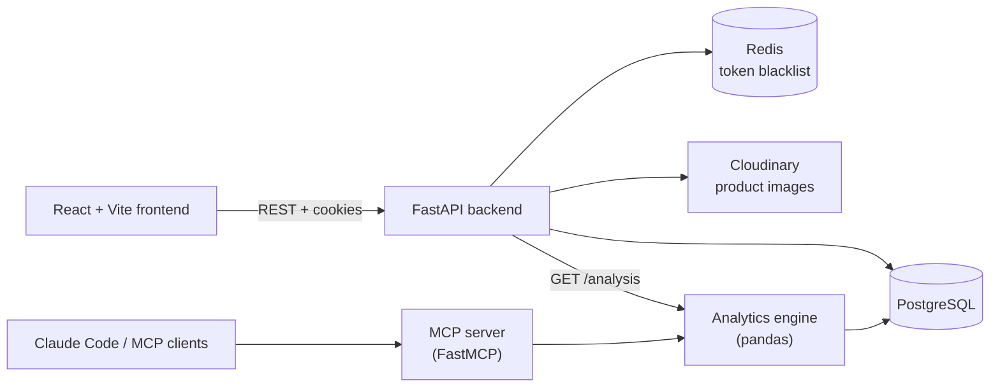
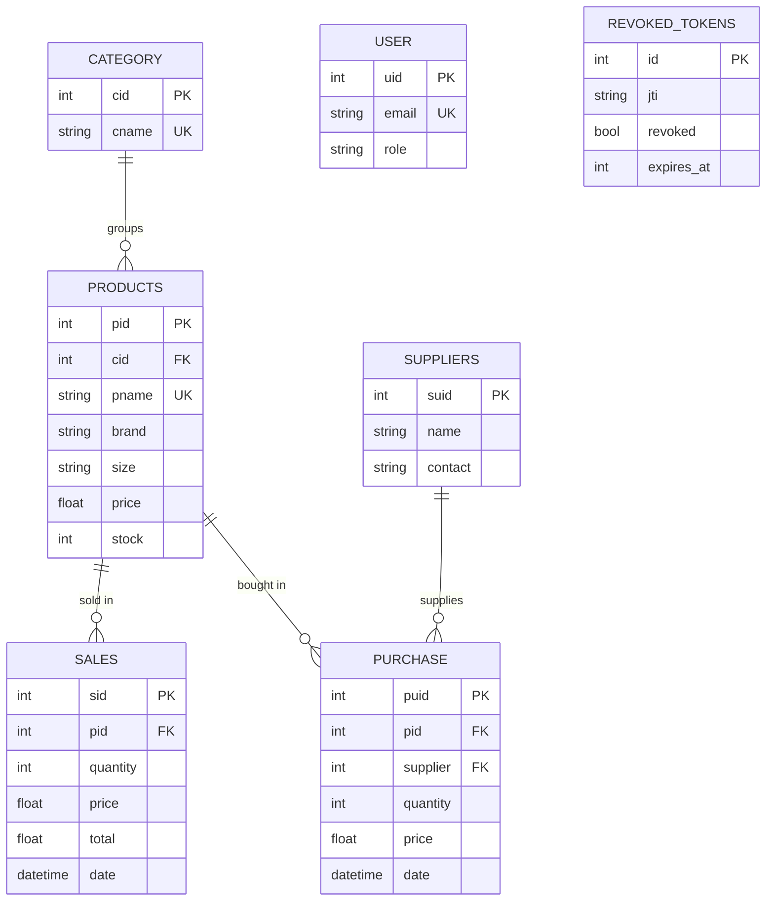

# Invenship

**An inventory, sales and purchasing management platform with role-based access, a pandas-powered analytics engine, and an MCP server that lets AI assistants query live business data.**

Invenship helps a retail business keep track of what it stocks, what it sells, what it buys and from whom. Staff work through a React dashboard, the FastAPI backend enforces who may do what, and an analytics layer turns raw transactions into reports. The same analytics are exposed as tools through the Model Context Protocol (MCP), so an assistant such as Claude Code can answer questions like *"which products are low on stock?"* directly from the database.

---

## Features

- **Secure authentication**: JWT access and refresh tokens in httpOnly cookies, bcrypt password hashing, and token revocation backed by Redis and PostgreSQL.
- **Role-based access control**: `admin` and `receptionist` roles, enforced on the server with FastAPI dependencies.
- **Product catalogue**: products with brand, size, price and stock, grouped by category, with image uploads to Cloudinary.
- **Sales tracking**: recording a sale validates stock, saves the transaction and updates inventory in a single database transaction.
- **Purchasing and suppliers**: record stock bought from suppliers and keep a supplier directory.
- **Analytics engine**: inventory value, low and out-of-stock alerts, top sellers, revenue by brand and size, and supplier spend.
- **AI-ready**: an MCP server exposes the analytics as tools for AI assistants.
- **Tested service layer**: unit tests for every backend service module.

## Architecture



The backend follows a layered design: **routes** (HTTP and permissions) call **services** (business rules), which call **models** (database queries). **Schemas** (Pydantic) validate request bodies.

## Tech stack

| Layer | Technology |
|---|---|
| Backend | Python 3.12+, FastAPI, SQLAlchemy, Pydantic, PyJWT, bcrypt |
| Data | PostgreSQL, Redis |
| Media | Cloudinary |
| Analytics | pandas, NumPy |
| AI integration | FastMCP (Model Context Protocol) |
| Frontend | React 19, Vite |
| Testing | pytest |
| Tooling | uv (`pyproject.toml` + `uv.lock`) |

## Modules

| Module | What it does | Docs |
|---|---|---|
| **Users and Auth** | Login, logout, token refresh, password change, profile | [docs/modules/users](docs/modules/users/README.md) |
| **Admin** | User management for administrators | [docs/modules/admin](docs/modules/admin/README.md) |
| **Products** | Product catalogue, categories and image upload | [docs/modules/products](docs/modules/products/README.md) |
| **Sales** | Record and review sales, automatic stock deduction | [docs/modules/sales](docs/modules/sales/README.md) |
| **Purchases** | Record stock purchased from suppliers | [docs/modules/purchases](docs/modules/purchases/README.md) |
| **Suppliers** | Supplier directory | [docs/modules/suppliers](docs/modules/suppliers/README.md) |
| **Analytics engine** | Reports on inventory, sales, purchases and suppliers | [analytics_engine](analytics_engine/README.md) |
| **MCP server** | Analytics as tools for AI assistants | [mcp_server](mcp_server/README.md) |
| **Frontend** | React dashboard | [frontend](frontend/README.md) |
| **Backend overview** | Layering, configuration, running and testing | [backend](backend/README.md) |

## Roles and permissions

| Capability | admin | receptionist |
|---|:---:|:---:|
| View products and categories | ✅ | ✅ |
| Create, update, delete products and categories | ✅ | ❌ |
| View and record sales | ✅ | ✅ |
| Clear sales history | ✅ | ❌ |
| Purchases and suppliers | ✅ | ❌ |
| Manage users | ✅ | ❌ |
| Analytics report | ✅ | ❌ |
| Own profile and password | ✅ | ✅ |

## Data model



## Project structure

```text
Invenship/
├── backend/            FastAPI app: routes, services, models, schemas, auth, tests
├── analytics_engine/   pandas analysis modules + database access
├── mcp_server/         FastMCP server exposing analytics as tools
├── frontend/           React + Vite dashboard
├── docs/modules/       Per-module documentation
├── env_loader.py       Loads the shared .env from the project root
├── pyproject.toml      Python project and dependencies (uv)
└── uv.lock
```

## Getting started

### Prerequisites

- Python 3.12 or newer and [uv](https://docs.astral.sh/uv/)
- Node.js 20 or newer
- PostgreSQL and Redis running locally
- A Cloudinary account (only needed for product image uploads)

### 1. Install

```bash
git clone https://github.com/Mohd-Furkhan-lab/Invenship.git
cd Invenship
uv sync                       # Python dependencies
cd frontend && npm install    # Frontend dependencies
```

### 2. Configure

Create a `.env` file in the project root. **Never commit it.**

| Variable | Purpose |
|---|---|
| `DATABASE_URL` | SQLAlchemy connection string for PostgreSQL |
| `SECRET_KEY` | Secret used to sign JWTs |
| `cloud_name`, `api_key`, `api_secret` | Cloudinary credentials |

Redis is expected at `localhost:6379`.

### 3. Run

```bash
# Backend, from the project root (tables are created on startup)
uvicorn backend.run:app --reload --port 8000

# Frontend
cd frontend && npm run dev          # http://localhost:5173
```

Interactive API docs are served by FastAPI at `http://127.0.0.1:8000/docs`.

The first administrator must be created directly in the database (admin endpoints need an existing admin). Hash the password with bcrypt before inserting it.

### 4. Test

```bash
pytest backend/tests
```

## Using Invenship with an AI assistant

The MCP server exposes read-only analytics tools. Connect it to Claude Code:

```bash
claude mcp add invenship -- uv run python -m mcp_server.server
```

See [mcp_server](mcp_server/README.md) for the full tool list and HTTP mode.

## Roadmap

- Docker Compose for one-command setup
- Continuous integration (tests and linting)
- Route-level and analytics tests
- Secure cookies and production CORS configuration
- Pagination controls for sales and purchase history

## Author

**Mohd Furkhan**, Python backend developer. [GitHub](https://github.com/Mohd-Furkhan-lab)